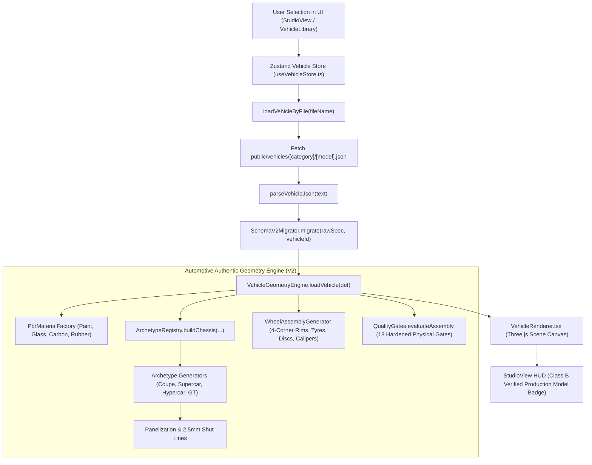

# AUTOVERSE 3D — SYSTEM DEPENDENCY MAP

## 1. Data Flow & Component Hierarchy

## 2. Core Package Dependencies
- `@autoverse/shared-types`: Canonical vehicle types and component override schemas.
- `@autoverse/vehicle-generation-engine`: Parametric geometry builders and diagnostic tools.
- `@autoverse/gta-compat`: Joaat hash calculation and GTA color palette utilities.
- `@autoverse/authentic-geometry-engine`: Quality classifier and provenance certification.
