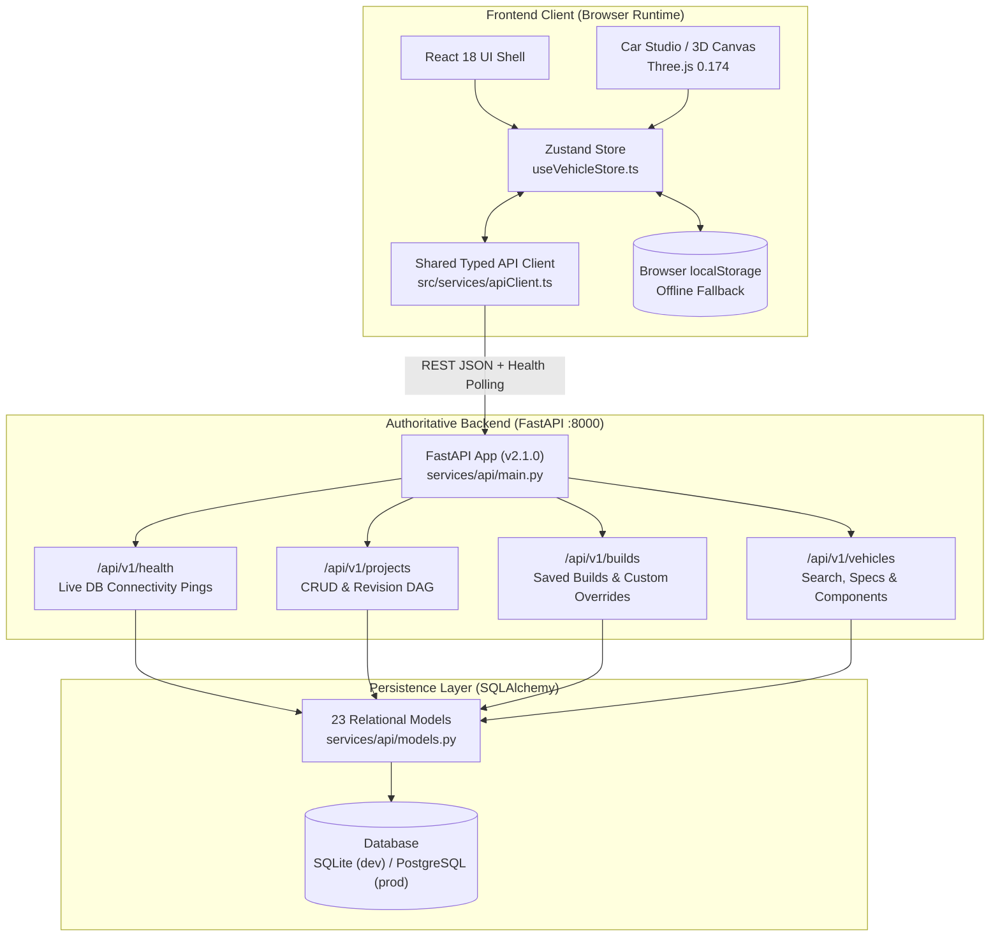

# AUTOVERSE SYSTEM INTEGRATION DESIGN
## Phase 21: Client-Server Architecture, Data Access & Synchronization Engine

**Author:** Principal Software Architect & Systems Lead  
**Status:** IMPLEMENTED & VERIFIED  
**Date:** November 23, 2026  

---

### 1. Architectural Overview

AutoVerse has transitioned from an isolated client-side prototype to a fully connected, persistent automotive engineering platform. The authoritative application backend is **FastAPI** (`services/api/`) backed by **SQLAlchemy** with support for local **SQLite WAL** and enterprise **PostgreSQL**.

---

### 2. Dual-Layer Persistence & Offline Resiliency

AutoVerse implements an **optimistic, offline-first synchronization strategy**:

1. **Immediate Local Response:**
   When an engineer saves a custom build in the Car Studio, `saveCurrentBuild()` writes the full configuration to browser `localStorage` synchronously. The UI never stalls or locks waiting for network round-trips.
2. **Asynchronous Backend Persistence:**
   In parallel, `apiClient.createBuild()` transmits the build payload (including canonical slot overrides, donor part IDs, scale matrices, and custom PBR colors) to `POST /api/v1/builds`.
3. **Graceful Offline Degradation:**
   If the backend server is unreachable or the network drops:
   - The build remains safely persisted in `localStorage`.
   - `saveStatus` is set to `'failed'` and logged.
   - The Top Context Bar status pill switches to **`OFFLINE (LOCAL)`** (rose indicator).
   - Zero user customizations or aerodynamic tweaks are lost.
4. **Reconnection & Synchronization:**
   Upon regaining connection, `syncBuildsWithBackend()` merges server records with local builds, maintaining state parity without overwriting newer client data.

---

### 3. Truthful System Health Monitoring

The hardcoded `useState(true)` indicator has been permanently eradicated from [`src/components/shell/TopContextBar.tsx`](file:///c:/Users/deeks/Downloads/cars/src/components/shell/TopContextBar.tsx). Health is derived from live HTTP requests to `/api/v1/health`:

| State | Indicator | Criteria | User Guidance |
| :--- | :---: | :--- | :--- |
| **ONLINE** | Emerald dot | Backend process alive; database ping (`SELECT 1`) succeeds in $< 10\,\text{ms}$. | Full cloud persistence, project DAG, and build synchronization active. |
| **DEGRADED** | Amber pulse | Backend process responds, but database query throws exception or locks. | Local edits preserved; database write retries queued. |
| **CONNECTING** | Cyan pulse | Health probe in-flight or reconnecting. | Checking system state. |
| **OFFLINE** | Rose dot | Network failure or backend daemon stopped on port 8000. | Studio operating in local mode; builds saved to browser cache. |
