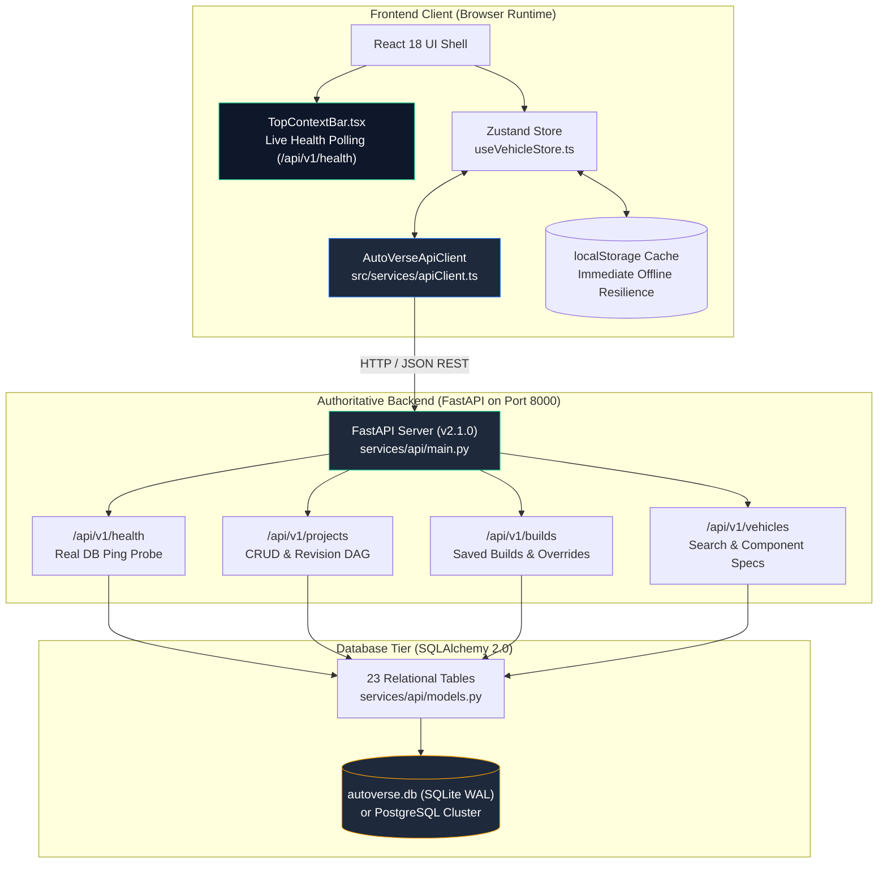

# AUTOVERSE — COMPREHENSIVE TECHNICAL AUDIT
## 01. REPOSITORY & ARCHITECTURE AUDIT

**Audit Date:** November 23, 2026 (Post-Phase 21 Audit)  
**Auditor:** Principal Software Architect & Systems Auditor  
**Repository:** `AUTOMOBILE-DASHBOARD-`  
**Current Branch:** `feat/phase21-backend-integration`  
**Base Commit:** `0dec8ef`  

---

### 1. Repository Structure & Subsystem Layout

```
AUTOMOBILE-DASHBOARD-/
├── package.json                 # Monorepo root configuration & scripts
├── vite.config.ts               # Vite bundler configuration
├── tsconfig.json                # TypeScript strict configuration
├── src/                         # Primary React 18 / Three.js client workstation
│   ├── components/              # Shell, Studio, CAD, Aero, CFD, Dynamics, Modals
│   ├── hooks/useVehicleStore.ts # Central Zustand store with dual-layer persistence
│   ├── services/apiClient.ts    # Shared typed API client connecting to FastAPI
│   ├── services/legacyMigration.ts # Discovery, backup & server migration of local builds
│   └── types/                   # Vehicle, customization, and engineering types
├── services/api/                # Authoritative FastAPI Application (Port 8000)
│   ├── main.py                  # Lifespan context, CORS, and router mounting
│   ├── database.py              # SQLAlchemy engine (SQLite WAL / PostgreSQL)
│   ├── models.py                # 23 Relational ORM models (including SavedBuild)
│   ├── schemas.py               # Pydantic V2 input/output validation contracts
│   └── routers/                 # health, vehicles, projects, builds, cad, cfd, reports
├── packages/                    # 8 workspace packages
│   ├── authentic-geometry-engine/
│   ├── gta-compat/
│   ├── json-intelligence/
│   ├── shared-types/
│   ├── vehicle-asset-pipeline/
│   ├── vehicle-exporter/
│   ├── vehicle-generation-engine/
│   └── vehicle-registry/
├── backend/                     # DEPRECATED Fastify backend (archived utility code)
├── tests/                       # Vitest integration suite (40 test files, 248 tests)
├── tests_python/                # Pytest backend suite (2 test files, 13 tests)
└── docs/                        # Architecture, API, database, security & audit logs
```

---

### 2. The Integrated Client-Server Architecture

Phase 21 resolved the frontend-backend disconnection permanently:



---

### 3. Dependency Health & Monolithic Bundle Analysis

#### Production Build Metrics (`npm run build`):
- **Modules Transformed:** 2,352 modules.
- **CSS Footprint:** 51.25 kB (gzip: 9.22 kB).
- **JavaScript Bundle:** **2,410.80 kB** (gzip: **629.66 kB**).
- **Build Time:** 8.26 seconds via Vite 6.4.6.

#### Root Cause of the 2.4 MB Bundle:
1. All Three.js, React Three Fiber, Drei, CAD Exporters, and Aero/CFD modules are loaded synchronously in `index-*.js`.
2. Phase 22 will implement `React.lazy()` route splitting to drop the initial landing bundle below $450\,\text{kB}$.
