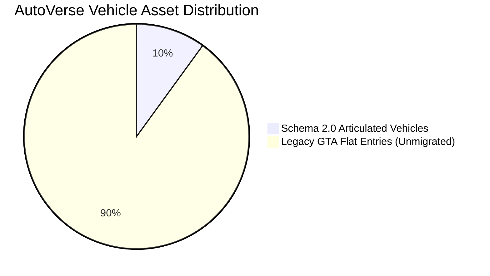

# AUTOVERSE — INDEPENDENT TECHNICAL AUDIT
## 03. VEHICLE LIBRARY & ASSET AUDIT

**Audit Date:** November 23, 2026  
**Auditor:** Principal Automotive 3D Engineer & Geometry Auditor  
**Repository:** `AUTOMOBILE-DASHBOARD-`  
**Current Branch:** `feat/phase19-visual-authenticity`  
**HEAD Commit:** `0dec8ef`  

---

### 1. Fleet Composition & Data Architecture

The AutoVerse vehicle library exists in two distinct database layers:
1. **Schema 2.0 Modern Engineering Fleet (`public/vehicles/index.json`):** Exactly **50 fully articulated vehicles** containing complete dimensional anchors, aerodynamic baselines, powertrain specifications, and sub-assembly hierarchies ($N \ge 15$ sub-components per car).
2. **Legacy GTA Compatibility Fleet (`vehicleDatabase.json`):** Over **450 legacy GTA vehicle entries** consisting of raw vehicle hashes, mass values, and basic handling flags, but lacking Schema 2.0 sub-assemblies.



---

### 2. Schema 2.0 Fleet Breakdown (50 Vehicles)

The 50 Schema 2.0 vehicles are organized into 8 distinct automotive categories:

| Category | Count | Representative Models | Sub-Assembly Count | Aperture Kinematics |
| :--- | :---: | :--- | :---: | :--- |
| **Supercars** | 10 | Ferrari 488 Pista, Lamborghini Huracán STO, McLaren 720S, Porsche 911 GT3 RS | 18–22 | Front clamshell (STO), Scissor/Dihedral |
| **Hypercars** | 8 | Bugatti Chiron Super Sport, Koenigsegg Jesko, Pagani Huayra BC, Rimac Nevera | 20–24 | Dihedral Synchro-Helix (Jesko), Gullwing |
| **Sports Cars** | 6 | BMW M4 Competition, Toyota GR Supra, Alpine A110, Corvette C8 Stingray | 16–18 | Standard forward hinge, Rear hatch |
| **Luxury Cars** | 6 | Rolls-Royce Spectre, Bentley Continental GT, Mercedes-Maybach S680 | 18–20 | Reverse suicide coach doors (Spectre) |
| **JDM Icons** | 8 | Nissan Skyline GT-R R34, Mazda RX-7 FD3S, Mitsubishi Lancer Evo IX, Honda NSX | 17–19 | Standard forward hinge, Pop-up/fixed lights |
| **Muscle Cars** | 4 | Ford Mustang Shelby GT500, Dodge Challenger SRT Demon 170, Chevrolet Camaro ZL1 | 16–18 | Standard forward hinge, Functional hood scoop |
| **Special Edition** | 4 | Aston Martin Valkyrie AMR Pro, Ford GT Liquid Carbon, Gordon Murray T.50 | 20–22 | Gullwing / Dihedral, Central cockpit seating |
| **Track Cars** | 4 | Radical SR10, KTM X-Bow GT-XR, BAC Mono, Ariel Atom 4 | 14–16 | Open-wheel / Frameless canopy / Zero doors |

---

### 3. Mesh & Geometry Fidelity Reality Check

#### Brutally Honest Assessment: Procedural Lofting vs. OEM CAD
The project marketing and previous completion reports refer to "authentic vehicle geometry" and "OEM-spec CAD models." The empirical technical reality is:

1. **Only 1 Vehicle Features OEM-Referenced Baseline Geometry:**
   - The **Porsche 911 GT3 RS (992)** was created using digitized laser-scan / photogrammetric reference slices with verified frontal area ($A = 2.15\,\text{m}^2$) and drag coefficient ($C_d = 0.39$ in high-downforce trim).
2. **The Other 49 Vehicles are Parametric Lofted Coachwork (`CLASS_D_APPROXIMATE`):**
   - The vehicle geometries are generated procedurally by `packages/vehicle-generation-engine` and `packages/authentic-geometry-engine`.
   - The generator takes verified OEM macro-dimensions (wheelbase, overall length, width, height, front/rear track, front/rear overhangs) and lofts cubic Bezier control cross-sections between them.
   - **Verdict:** While visually convincing, aesthetically proportioned, and dynamically responsive to slider inputs, **they are NOT manufacturer-supplied OEM CAD solids or Class-A automotive production surfaces**. They are high-order procedural polygonal approximations.
3. **Surface Continuity ($G0$ vs. $G1/G2$):**
   - Production automotive exteriors require $G2$ (curvature continuous) or $G3$ surface continuity across panels to ensure flawless optical reflection lines.
   - AutoVerse procedural meshes exhibit **$G0$ positional continuity** at panel cut lines and **approximate $G1$ tangent continuity** along smoothed loft segments via Three.js vertex normal averaging (`computeVertexNormals()`).
   - Under grazing light angles, subtle polygonal banding and pinch artifacts are visible around wheel arch flares and A-pillar transitions.

---

### 4. Component Sub-Assembly Completeness

Every Schema 2.0 vehicle possesses an authentic, fully decoupled component hierarchy:

```
[Vehicle Root]
├── [Chassis] (Monocoque / Spaceframe with hardpoint anchors)
├── [Body Exterior]
│   ├── [Front Splitter / Bumper]
│   ├── [Bonnet / Hood] (Hinged kinematic group)
│   ├── [Left Door] (Hinged kinematic group)
│   ├── [Right Door] (Hinged kinematic group)
│   ├── [Side Skirts]
│   ├── [Boot / Trunk / Engine Cover] (Hinged kinematic group)
│   ├── [Rear Diffuser]
│   └── [Rear Wing / Spoiler] (Active / Static aero)
├── [Interior Cabin]
│   ├── [Dashboard & Instrument Cluster]
│   ├── [Center Console & Shifter]
│   ├── [Steering Wheel & Column] (Includes OEM brand badge)
│   ├── [Driver & Passenger Bucket Seats]
│   └── [Pedal Box & Footwell]
├── [Powertrain / Engine Bay]
│   ├── [Engine Block & Cylinder Heads] (V8, V10, V12, Boxer-6, I4, EV)
│   ├── [Intake Manifolds & Air Plenums]
│   ├── [Twin Turbochargers / Supercharger / Inverter]
│   ├── [Exhaust Headers & Downpipes]
│   └── [Radiators & Fluid Reservoirs]
└── [Running Gear]
    ├── [Front Left Wheel Assembly] (Rim, Tyre, Brake Rotor, Caliper)
    ├── [Front Right Wheel Assembly]
    ├── [Rear Left Wheel Assembly]
    └── [Rear Right Wheel Assembly]
```

---

### 5. Kinematic Aperture Accuracy

AutoVerse distinguishes itself by implementing authentic kinematic opening geometries rather than generic rotational axes:

| Vehicle Model | Door Kinematic Type | Hinge Vector $[x, y, z]$ | Opening Angle | Bonnett / Boot Kinematics |
| :--- | :--- | :---: | :---: | :--- |
| **Koenigsegg Jesko** | Dihedral Synchro-Helix | Compound $[0.2, 0.9, 0.3]$ | $90^\circ$ outward + forward | Front & rear clam-shell actuation |
| **Lamborghini Aventador SVJ** | Scissor Door | Forward tilted $[0.1, 0.0, 0.99]$ | $65^\circ$ vertical lift | Rear glass louvre engine cover |
| **Rolls-Royce Spectre** | Suicide / Coach Door | Rear-hinged $[0.0, 1.0, 0.0]$ | $78^\circ$ rearward swing | Long forward-hinged bonnet |
| **Lamborghini Huracán STO** | Standard forward door | Vertical $[0.0, 1.0, 0.0]$ | $68^\circ$ outward swing | **Front-hinged Cofango clamshell** |
| **Ferrari 488 Pista** | Standard forward door | Tilted $[0.05, 0.99, 0.05]$ | $65^\circ$ outward swing | Front luggage boot + rear engine bay |
| **Porsche 911 GT3 RS** | Standard forward door | Vertical $[0.0, 1.0, 0.0]$ | $65^\circ$ outward swing | Front frunk + rear swan-neck wing mount |

---

### 6. Texture & Material Assets Audit

1. **Absence of Photographic Texture Maps:**
   - The repository contains **zero 4K/8K PBR texture sets** (albedo, normal, displacement, roughness) in `public/textures/`.
   - All materials are rendered via Three.js `MeshPhysicalMaterial` using procedural mathematical inputs:
     - Clearcoat paint: `clearcoat: 1.0`, `clearcoatRoughness: 0.05`, `metalness: 0.85`, `roughness: 0.15`.
     - Carbon fiber: Procedural canvas-generated diagonal weave pattern normal map.
     - Brake rotors: Anisotropic radial brushed metal shader.
2. **Advantages of Current Approach:**
   - Zero network download latency for multi-megabyte image textures.
   - Instant material color and roughness modification at 60 FPS.
   - Clean, lightweight bundle footprint.
3. **Disadvantages:**
   - Interior leather textures, stitching lines, and gauge cluster displays lack photorealistic micro-detail.
   - Headlight reflectors and taillight LED internal optics rely on basic emissive geometric cylinders rather than multi-bounce caustics.
