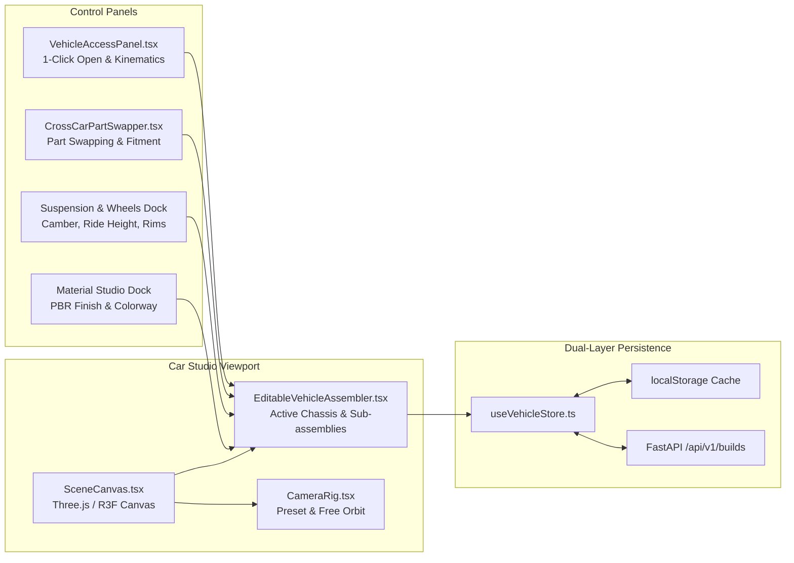

# AUTOVERSE — COMPREHENSIVE TECHNICAL AUDIT
## 04. CAR STUDIO & CUSTOMIZATION AUDIT

**Audit Date:** November 23, 2026 (Post-Phase 21 Audit)  
**Auditor:** Senior Automotive Customization & 3D Specialist  
**Repository:** `AUTOMOBILE-DASHBOARD-`  
**Current Branch:** `feat/phase21-backend-integration`  

---

### 1. Car Studio Architecture & User Workflow

The Car Studio (`src/components/studio/`) serves as the visual and interactive centerpiece of AutoVerse, combining real-time 3D rendering, aerodynamic modification, material formulation, stance tuning, and aperture kinematics.

---

### 2. Exterior Customization & Canonical Hardpoint Anchors

1. **Aero Component Slots:**
   - `front_splitter`: Translates and scales dynamically with front overhang and ground clearance.
   - `rear_wing` / `rear_spoiler`: Aligns to rear decklid hardpoints, featuring active angle-of-attack adjustment ($-4^\circ$ to $+28^\circ$).
   - `side_skirts`: Dynamic length matching between front and rear wheel arches.
   - `rear_diffuser`: Scales with rear track width; integrates with underbody flow.
   - `exhaust_system`: Dual, quad, or center-exit configurations with titanium/chrome finishes.
2. **Wheels, Tyres & Stance Tuning:**
   - Rim diameter (17"–22"), rim width (7.5"–13.0").
   - Tyre aspect ratio recomputes sidewall height to maintain rolling radius within $\pm 3\%$ of OEM spec.
   - Suspension camber ($-0.5^\circ$ to $-4.5^\circ$), track width offset spacers, and ride height drop ($0$ to $-60\,\text{mm}$).

---

### 3. Materials, Paint & Shading Engine

1. **PBR Finishes:**
   - Gloss Solid, Metallic / Pearl, Satin / Semi-Gloss, Matte Stealth, and Exposed Carbon Fiber.
   - Live color updates to Primary Coachwork, Secondary Trim, Aero Elements, Rims, Brake Calipers, and Interior Upholstery.

---

### 4. Vehicle Access & Kinematic Aperture Engine

1. **1-Click "Open Everything" / "Close Everything":**
   - Coordinates synchronized multi-axis kinematics across left door, right door, hood/bonnet, and boot/engine decklid via `useFrame` exponential decay smoothing (`THREE.MathUtils.damp`).
2. **Vehicle-Specific Kinematic Geometries:**
   - Scissor Doors (Aventador SVJ), Dihedral Synchro-Helix (Jesko), Suicide / Coach Doors (Spectre), Cofango Front Clamshell (Huracán STO).

---

### 5. Cross-Car Part Swapping Engine

1. **Canonical Slot Mapping & Fitment Scoring:**
   - Allows mounting parts from Car A onto Car B with scaling compensation and algorithmic fitment compatibility scoring ($0–100\%$).
   - High mismatches flag yellow warning badges with exact dimensional deltas.

---

### 6. Dual-Layer Saved Custom Builds (Phase 21 Breakthrough)

1. **Prior Deficit (Resolved):** In Phase 20, builds existed only in browser `localStorage`, subject to quota errors and silent deletion.
2. **Current Verified Architecture:**
   - When a user clicks "Save Build", `useVehicleStore.saveCurrentBuild()` executes an **optimistic dual-write**:
     1. Synchronously updates `localStorage` and memory for instant UI response and offline protection.
     2. Asynchronously transmits the complete build configuration to `POST /api/v1/builds`.
   - The build is stored in the `saved_builds` database table, surviving browser cache wipes, computer reboots, and cross-browser sessions.
   - Legacy builds in `localStorage` can be migrated to the database in 1 click via [`LegacyMigrationModal.tsx`](file:///c:/Users/deeks/Downloads/cars/src/components/modals/LegacyMigrationModal.tsx).
