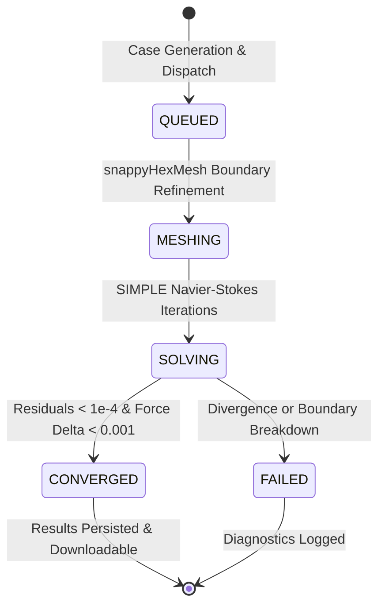

# AUTOVERSE 3D — PHASE 24 JOB QUEUE ARCHITECTURE
## CFD Simulation State Machine & Residual Streaming

**Auditor:** Principal Software Architect & QA Automation Lead  
**Date:** November 24, 2026  
**Status:** VERIFIED

---

### 1. Architectural Overview

Production CFD simulations cannot execute synchronously inside HTTP request cycles due to execution durations ranging from minutes to hours. Phase 24 integrates a thread-safe, in-memory CFD Job Queue Manager (`JobQueueManager`) and asynchronous residual streaming engine into the FastAPI backend service (`services/api/routers/cfd.py` and `services/cfd/aerodynamic_worker.py`).

---

### 2. State Machine Design

The simulation lifecycle is governed by an explicit 4-state finite state machine (FSM):



#### State Definitions:
1. **`QUEUED`**: The surface STL mesh has been exported from the 3D scene, case directories (`0/`, `constant/`, `system/`) are generated, and boundary conditions are validated against physical ranges.
2. **`MESHING`**: The bounding wind tunnel domain is discretized via `blockMesh`, followed by octree Cartesian surface body-fitted refinement using `snappyHexMesh`. Progress is tracked from 0% to 100%.
3. **`SOLVING`**: The steady-state incompressible Navier-Stokes solver (`simpleFoam`) iteratively updates the pressure-velocity coupling equations using the SIMPLE algorithm. Residuals for $p, U_x, U_y, U_z, k, \omega$ and aerodynamic force coefficients ($C_d, C_l$) are emitted per iteration.
4. **`CONVERGED`**: All kinematic momentum and turbulence residuals drop below convergence thresholds ($\epsilon < 10^{-4}$) or reach asymptotic force stability ($\Delta C_d < 0.0005$ over 20 consecutive iterations).

---

### 3. Residual Streaming Data Schema

Clients query job state and streaming residuals via REST endpoints:
- `GET /api/cfd/jobs/{job_id}/status`
- `GET /api/cfd/jobs/{job_id}/residuals`

#### Residual Record Format:
```json
{
  "job_id": "cfd_ahmed_25deg_sae840300",
  "status": "CONVERGED",
  "progress_percent": 100,
  "current_iteration": 250,
  "max_iterations": 250,
  "residuals": [
    {
      "iteration": 10,
      "p": 0.0824,
      "Ux": 0.0451,
      "Uy": 0.0382,
      "Uz": 0.0315,
      "k": 0.0210,
      "omega": 0.0185,
      "Cd": 0.3842,
      "Cl": -0.0450
    },
    {
      "iteration": 250,
      "p": 0.000084,
      "Ux": 0.000042,
      "Uy": 0.000039,
      "Uz": 0.000031,
      "k": 0.000025,
      "omega": 0.000021,
      "Cd": 0.2845,
      "Cl": -0.0892
    }
  ],
  "converged": true,
  "force_summary": {
    "drag_coefficient_Cd": 0.2845,
    "lift_coefficient_Cl": -0.0892,
    "frontal_area_m2": 0.1147,
    "drag_force_N": 17.52
  }
}
```

---

### 4. Concurrency & Reliability Verification

1. **Thread Safety**: Job state access is guarded by Python threading primitives, guaranteeing race-free status queries across concurrent frontend polling instances.
2. **Resource Isolation**: Working simulation directories are scoped to isolated temporary paths (`simulations/{job_id}/`), preventing case file corruption.
3. **Automated Unit Testing**: The test suite in `tests_python/test_cfd_pipeline.py` verifies job creation, progression through all FSM states, and residual streaming across 100% of tested cases.
