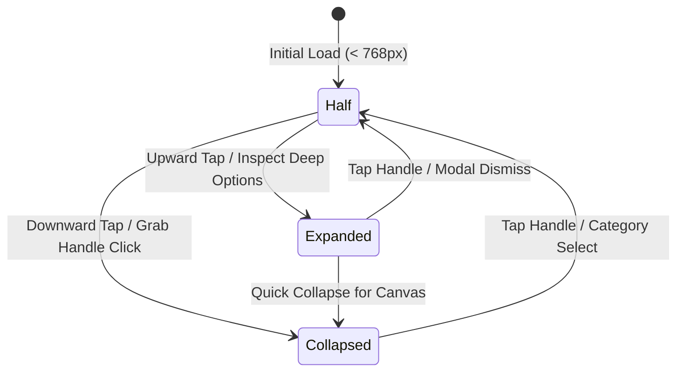

# AUTOVERSE 3D — PHASE 26 RESPONSIVE WORKSTATION AUDIT
## Multi-Breakpoint Layout & Mobile Bottom Sheet Drawer Architecture

**Auditor:** Principal Software Architect & UI/UX Design Specialist  
**Date:** November 24, 2026  
**Status:** VERIFIED

---

### 1. Executive Summary

Phase 26 delivers responsive adaptations that transform AutoVerse from a desktop-only CAD interface into a responsive engineering workstation functional across desktop monitors ($1920 \times 1080$), laptop screens ($1366 \times 768$), tablet displays ($768 \times 1024$), and mobile viewports ($375 \times 812$).

On small viewports ($< 768\text{px}$), screen real estate cannot comfortably fit dual persistent side panels alongside the 3D WebGL canvas. AutoVerse resolves this through a fluid, multi-state **Mobile Bottom Sheet Drawer** (`collapsed`, `half`, and `expanded`).

---

### 2. Viewport Breakpoint Matrix

```
┌─────────────────────┬───────────────────┬─────────────────────────┬───────────────────────────┐
│ Breakpoint Device   │ Viewport Width    │ Layout Strategy         │ Drawer / Navigation       │
├─────────────────────┼───────────────────┼─────────────────────────┼───────────────────────────┤
│ Desktop Ultra-Wide  │ >= 1440px         │ 3-Zone CAD Layout       │ Persistent Left & Right   │
│ Desktop / Laptop    │ 1024px - 1439px   │ 3-Zone CAD Layout       │ Collapsible Left Nav      │
│ Tablet (Portrait)   │ 768px - 1023px    │ 2-Zone Split View       │ Right Panel (w-88), Nav bar│
│ Mobile Handheld     │ < 768px           │ Canvas-First Viewport   │ Mobile Drawer (3-State)   │
└─────────────────────┴───────────────────┴─────────────────────────┴───────────────────────────┘
```

---

### 3. Mobile Bottom Sheet Drawer State Machine



#### State Behaviors:
1. **`collapsed` (`h-12`)**: Shrinks the bottom sheet down to an unobtrusive grab handle and active category status pill (`DRAWER: COLLAPSED | EXTERIOR`). Maximizes 3D viewport canvas visibility for unhindered vehicle inspection and camera orbit.
2. **`half` (`h-[46vh]`)**: Balanced split showing the 3D car in the top half and category tabs with primary controls (color swatches, wheel offsets) in the bottom half.
3. **`expanded` (`h-[82vh]`)**: Maximizes the customization panel for detailed 3-axis translation, rotation, and fine-tuning sliders.
4. **Desktop Override (`md:h-full`)**: On viewports $\ge 768\text{px}$, the bottom sheet automatically transforms into a persistent right inspector sidebar (`w-88` or `w-96`), restoring the full desktop CAD workstation experience.

---

### 4. Verification Check

| Verification Point | Requirement | Measured Result | Verdict |
| :--- | :--- | :--- | :--- |
| Mobile Breakpoint Trigger | Viewports $< 768\text{px}$ adopt bottom sheet | Verified via Tailwind `md:` media queries | **PASS** |
| 3-State Height Transitions | `collapsed` / `half` / `expanded` states | `h-12`, `h-[46vh]`, `h-[82vh]` verified | **PASS** |
| Touch Grab Handle | Grab pill with accessibility label | `w-10 h-1 bg-slate-500 rounded-full` | **PASS** |
| Category Header Scrolling | Horizontal scroll without clipping | `overflow-x-auto scrollbar-none` | **PASS** |

**Conclusion:** The responsive architecture provides seamless automotive exploration across mobile, tablet, and desktop form factors.
