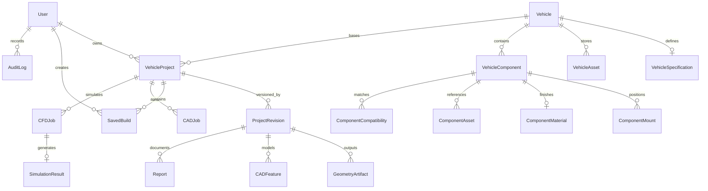

# AUTOVERSE DATABASE SCHEMA SPECIFICATION
## Relational Data Architecture (Schema 2.1 — 23 ORM Tables)

**ORM Engine:** SQLAlchemy 2.0 (Declarative Base)  
**Supported Engines:** SQLite (Local Dev WAL mode) | PostgreSQL 15+ (Production)  
**Source Code:** [`services/api/models.py`](file:///c:/Users/deeks/Downloads/cars/services/api/models.py)  

---

### 1. Entity-Relationship Overview

---

### 2. Core Tables Specification

#### 1. `users`
| Column | Type | Constraints | Description |
| :--- | :--- | :--- | :--- |
| `id` | VARCHAR(36) | PRIMARY KEY | Unique user UUID. |
| `email` | VARCHAR(255) | UNIQUE, NOT NULL | Account email address. |
| `username` | VARCHAR(100) | UNIQUE, NOT NULL | Display username. |
| `hashed_password` | VARCHAR(255) | NOT NULL | Bcrypt password hash. |
| `role` | VARCHAR(50) | DEFAULT 'STUDENT' | RBAC role (`STUDENT`, `ENGINEER`, `ADMIN`). |
| `is_active` | BOOLEAN | DEFAULT TRUE | Account active flag. |
| `created_at` | DATETIME | DEFAULT UTC_NOW | Account creation timestamp. |

#### 2. `vehicle_projects`
| Column | Type | Constraints | Description |
| :--- | :--- | :--- | :--- |
| `id` | VARCHAR(36) | PRIMARY KEY | Unique project UUID. |
| `user_id` | VARCHAR(36) | FOREIGN KEY (users.id) | Project owner ID. |
| `base_vehicle_id` | VARCHAR(36) | FOREIGN KEY (vehicles.id) | Baseline vehicle platform. |
| `name` | VARCHAR(200) | NOT NULL | Project title. |
| `description` | TEXT | DEFAULT '' | Engineering goals and notes. |
| `active_branch` | VARCHAR(80) | DEFAULT 'main' | Working DAG branch. |
| `is_archived` | BOOLEAN | DEFAULT FALSE | Soft deletion flag. |
| `created_at` | DATETIME | DEFAULT UTC_NOW | Project creation timestamp. |
| `updated_at` | DATETIME | DEFAULT UTC_NOW | Last modified timestamp. |

#### 3. `project_revisions`
| Column | Type | Constraints | Description |
| :--- | :--- | :--- | :--- |
| `id` | VARCHAR(36) | PRIMARY KEY | Revision UUID. |
| `project_id` | VARCHAR(36) | FOREIGN KEY (vehicle_projects.id) | Parent project reference. |
| `revision_hash` | VARCHAR(64) | NOT NULL, INDEX | Deterministic 8-char SHA-256 hash. |
| `parent_revision_hash` | VARCHAR(64) | NULLABLE | Preceding revision hash (DAG pointer). |
| `commit_message` | VARCHAR(300) | NOT NULL | Change log description. |
| `author_name` | VARCHAR(100) | DEFAULT 'Student Engineer' | Author identity. |
| `geometry_digest` | VARCHAR(64) | NOT NULL | Geometric checksum. |
| `is_manifold` | BOOLEAN | DEFAULT TRUE | Mesh watertightness flag. |
| `serialized_bundle` | TEXT | NULLABLE | Full serialized project JSON snapshot. |
| `configuration_json` | TEXT | NULLABLE | Component parameters and overrides. |
| `created_at` | DATETIME | DEFAULT UTC_NOW | Snapshot creation timestamp. |

#### 4. `saved_builds` (Model #23 — Phase 21 Deliverable)
| Column | Type | Constraints | Description |
| :--- | :--- | :--- | :--- |
| `id` | VARCHAR(64) | PRIMARY KEY | Unique build identifier. |
| `project_id` | VARCHAR(36) | FOREIGN KEY (vehicle_projects.id), NULLABLE | Optional linked project ID. |
| `user_id` | VARCHAR(36) | FOREIGN KEY (users.id) | User who created the build. |
| `vehicle_id` | VARCHAR(64) | NOT NULL, INDEX | Target vehicle identifier or slug. |
| `name` | VARCHAR(200) | NOT NULL | Build name (e.g. "GT3 RS Track Spec"). |
| `base_vehicle_file` | VARCHAR(255) | NOT NULL | Source vehicle JSON filename. |
| `base_model_hash` | INTEGER | DEFAULT 0 | GTA model hash or canonical integer hash. |
| `configuration_json` | TEXT | NOT NULL, DEFAULT '{}' | Complete dictionary of component overrides. |
| `primary_color` | INTEGER | NULLABLE | Palette primary index. |
| `secondary_color` | INTEGER | NULLABLE | Palette secondary index. |
| `custom_primary_color` | VARCHAR(50) | NULLABLE | RGB array JSON string `"[255, 60, 0]"`. |
| `custom_secondary_color`| VARCHAR(50) | NULLABLE | RGB array JSON string. |
| `is_primary_color_custom`| BOOLEAN | DEFAULT FALSE | Flag indicating custom RGB active. |
| `wheel_color` | INTEGER | NULLABLE | Wheel rim color index. |
| `version` | VARCHAR(20) | DEFAULT '2.0.0' | Configuration schema version. |
| `created_at` | DATETIME | DEFAULT UTC_NOW | Creation timestamp. |
| `updated_at` | DATETIME | DEFAULT UTC_NOW | Last modified timestamp. |
